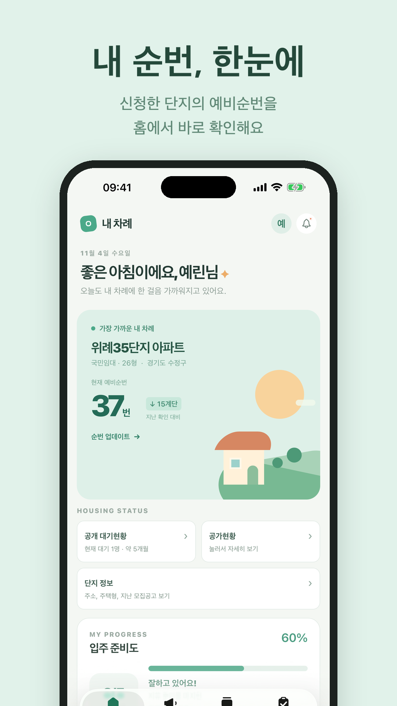
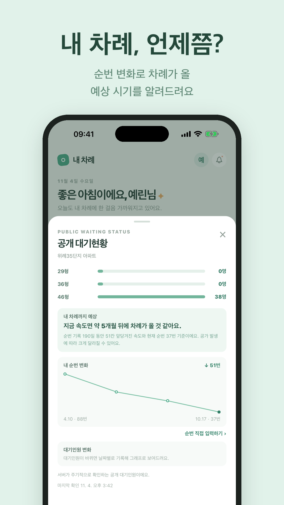
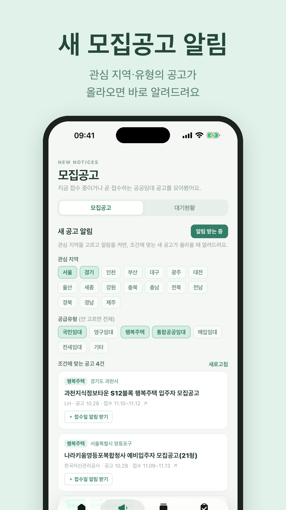
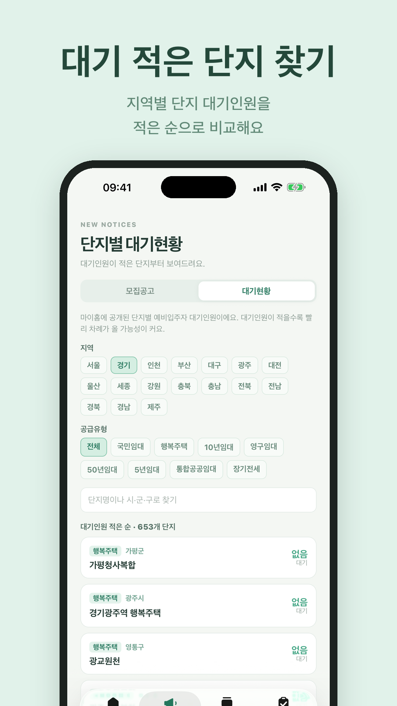
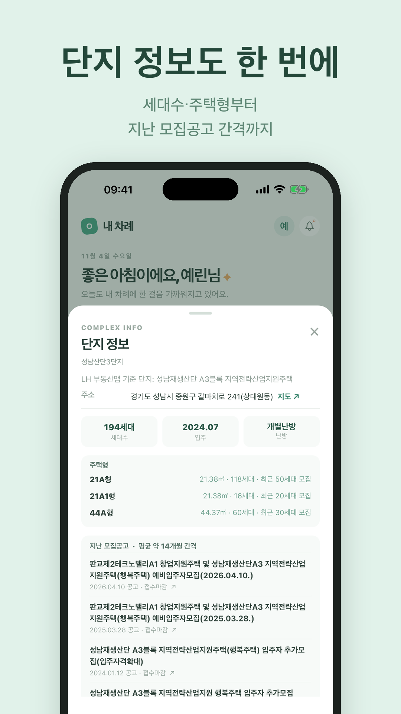
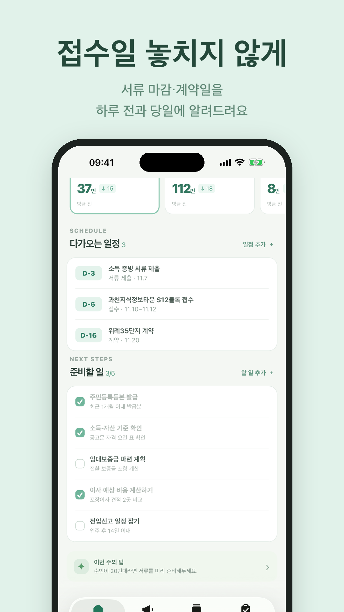

# 내 차례

> 임대주택 예비입주자의 신청 내역과 순번을 관리하고, 공개 대기현황·공가·새 모집공고를 알려주는 모바일 앱

<p>
  <a href="https://play.google.com/store/apps/details?id=kr.co.uulab.housingtracker"></a>
  <a href="https://apps.apple.com/kr/app/id6824419011"></a>
  
  
  
  
</p>

`내 차례`는 임대주택 예비입주자가 신청 정보를 한 곳에 모아두고, 순번 변화와 입주 준비 과정을 놓치지 않도록 돕는 iOS·Android 앱입니다.

## 📲 다운로드

| 플랫폼 | 링크 |
| --- | --- |
| Android | [Google Play에서 받기](https://play.google.com/store/apps/details?id=kr.co.uulab.housingtracker) |
| iOS | [App Store에서 받기](https://apps.apple.com/kr/app/id6824419011) |

- 소개 페이지: https://myturn.yyyerin.co.kr
- 기기별 스토어 바로가기: https://myturn.yyyerin.co.kr/download (iPhone → App Store, Android → Google Play)
- 개인정보처리방침: https://housing-api.yyyerin.co.kr/privacy
- 계정 삭제 안내: https://housing-api.yyyerin.co.kr/account-deletion

## ✨ 주요 기능

| 기능 | 설명 |
| --- | --- |
| 로그인 | 카카오·Apple 로그인으로 신청 내역과 알림 설정을 계정에 저장하고 다른 기기에서 불러옵니다. |
| 신청 내역 관리 | 공식 공고·단지를 검색해 등록하고, 길게 눌러 삭제합니다. |
| 순번 기록과 그래프 | 예비순번을 날짜별로 기록(지난 순번 직접 입력 포함)하고 순번·대기인원 변화를 그래프로 보여줍니다. |
| 내 차례 예상 시기 | 순번 기록, 최근 1년 퇴거 세대 수, 공개 대기인원이 줄어든 속도 순으로 차례가 올 시기를 추정합니다. |
| 공개 대기현황 | 마이홈 공공 API의 단지·주택형별 대기인원과 최근 1년 퇴거 세대 수를 보여주고, 대기인원이 변동되면 푸시로 알립니다. |
| 공가현황 · 단지 정보 | LH 부동산맵의 주택형별 공가, 세대수, 입주 시기, 지난 모집공고를 보여줍니다. |
| 모집공고 | 진행 중인 공공임대 공고를 지역·유형별로 보고, 최신순·마감 임박순·접수 시작순으로 정렬합니다. 조건에 맞는 새 공고는 푸시로 알립니다. |
| 단지별 대기현황 | 지역의 단지를 대기인원이 적은 순으로 비교하고, 주택형별 대기인원과 1년 퇴거 세대 수를 보여줍니다. |
| 일정 알림 | 접수·서류 마감·계약일을 추가하면 하루 전과 당일 오전 9시에 알립니다. |
| 입주 준비 체크리스트 | 6단계 추천 항목에서 골라 추가하거나 직접 적고, 마감일을 넣으면 하루 전과 당일 오전 9시에 알립니다. 진행률을 확인합니다. |
| 이번 주의 팁 | 홈에서 주마다 바뀌는 팁을 보여주고, 누르면 관련 화면으로 이동합니다. |

## 📱 화면 미리보기

<p align="center">
  
  
  
</p>
<p align="center">
  
  
  
</p>

## 🔄 동작 흐름

```text
카카오 · Apple 로그인
      ↓
신청 내역 등록 (서버 계정에 동기화)
      ↓
동기화 서버가 마이홈 공공 API · LH 부동산맵을 주기적으로 확인
      ↓
이전 대기인원 · 공가 · 공고 목록과 비교
      ↓
변동 · 새 공고가 있으면 푸시 알림
```

## ⚠️ 현재 API의 범위

마이홈 공공 API가 제공하는 값은 **개인별 예비순번이 아닌 단지별 공개 대기인원**입니다.

따라서 이 앱은 다음 두 정보를 구분해 관리합니다.

- 사용자가 직접 등록하는 개인 예비순번
- 공식 API로 자동 조회하는 단지별 공개 대기인원

대기인원이 줄어든 만큼 내 순번도 앞당겨졌을 수 있다고 **추정**해서 보여줄 뿐, 실제 순번은 LH·SH 등 공급기관에서 확인해야 합니다. 비밀번호, 주민등록번호, 공동인증서, 마이홈 개인 세션을 수집하거나 자동화하지 않습니다.

## 🧱 기술 스택

- Expo 57 / React Native 0.86 / TypeScript / Expo Router (Native Tabs)
- Kakao 네이티브 로그인 SDK · Sign in with Apple
- Expo Notifications (원격 푸시 · 로컬 일정 알림)
- EAS Build · EAS Update (fingerprint runtime 정책)
- Node.js 동기화 서버 (Docker)
- 마이홈 공공데이터 API (입주대기 현황 · 모집공고), LH 부동산맵

## 📁 프로젝트 구조

```text
housing-tracker-mobile/
├── src/
│   ├── app/                 # 홈 · 공고 · 내 신청 · 체크리스트 탭 화면
│   ├── components/          # 시트, 그래프, 달력, 공고·대기현황 목록 등 UI
│   ├── data/                # 로컬 저장 모델과 마이그레이션
│   └── services/            # 로그인 · 알림 · 동기화 · 공고 · 예상 시기 계산
├── server/
│   ├── index.mjs            # 동기화 API와 주기 실행 서버
│   ├── myhome-api.mjs       # 마이홈 입주대기 현황 API (지역 목록 캐시)
│   ├── notice-api.mjs       # 마이홈 모집공고 API
│   ├── lh-vacancy-api.mjs   # LH 부동산맵 공가 · 단지 정보
│   ├── apple-auth.mjs       # Apple 로그인 검증 · 연결 해제
│   ├── review-auth.mjs      # 스토어 심사용 계정
│   └── public/              # 소개 페이지 · 개인정보처리방침 · 계정 삭제 안내
├── plugins/                 # 로컬 Expo config plugin (iOS UIScene 생명주기)
├── Dockerfile               # 동기화 서버 이미지
├── docker-compose.yml       # 서버 배포 설정
├── app.config.js            # 카카오 SDK · Android 빌드 설정
├── app.json                 # Expo 앱 설정
└── .env.example             # 환경변수 예시
```

## 🚀 시작하기

### 1. 의존성 설치

Node.js LTS 환경에서 실행합니다.

```bash
npm install
```

### 2. 환경변수 설정

```bash
cp .env.example .env
```

`.env`에 필요한 값을 입력합니다.

```env
# 서버에서만 읽는 마이홈 공공데이터 인증키
MYHOME_API_KEY=

# 모바일 앱이 접근할 동기화 서버 주소
EXPO_PUBLIC_SYNC_SERVER_URL=http://127.0.0.1:8787

# 실기기 푸시에 필요한 EAS 프로젝트 ID
EXPO_PUBLIC_EAS_PROJECT_ID=

# 카카오 디벨로퍼스의 네이티브 앱 키
EXPO_PUBLIC_KAKAO_NATIVE_APP_KEY=
```

서버에는 카카오 토큰이 이 앱에서 발급됐는지 확인하기 위한 `KAKAO_APP_ID`(카카오 앱 ID, 숫자)도 설정합니다. 배포 설정은 `docker-compose.yml`에 있습니다.

`.env`는 저장소에 커밋하지 않습니다.

### 3. 카카오 네이티브 앱 설정

카카오 디벨로퍼스의 `플랫폼 키 → 네이티브 앱 키`에서 다음 정보를 등록합니다.

| 플랫폼 | 값 |
| --- | --- |
| iOS 번들 ID | `kr.co.uulab.housingtracker` |
| Android 패키지명 | `kr.co.uulab.housingtracker` |

Android 키 해시는 업로드 키와 Play 앱 서명 키를 모두 등록합니다. 카카오 로그인을 활성화하고 `profile_nickname` 동의항목을 설정한 뒤 네이티브 앱 키를 `.env`에 입력합니다.

### 4. 동기화 서버 실행

별도 터미널에서 실행합니다.

```bash
npm run server
```

서버 기본 주소는 `http://localhost:8787`입니다.

```bash
# 서버 상태 확인
curl http://localhost:8787/health

# 1회 동기화 실행
npm run server:sync
```

기본 조회 주기는 1시간이며, 필요하면 환경변수로 변경할 수 있습니다.

```bash
SYNC_INTERVAL_MINUTES=60 npm run server
```

마이홈 API는 하루 요청 수가 정해져 있어서, 서버는 지역별 대기현황 목록을 `server/data/waiting-rows-cache.json`에 저장해 두고 재시작해도 다시 받지 않습니다.

### 5. 개발 앱 실행

카카오 네이티브 SDK를 사용하므로 Expo Go가 아닌 개발 빌드를 사용합니다.

```bash
# Metro 실행
npx expo start --dev-client

# iOS 개발 빌드
npx expo run:ios --no-bundler

# Android 개발 빌드
npx expo run:android
```

캐시 문제로 이전 화면이 보이면 다음처럼 다시 시작합니다.

```bash
npx expo start --dev-client --clear
```

## 📦 배포

- **서버:** `server/`와 `docker-compose.yml`로 Docker 이미지를 만들어 상시 실행합니다. `server/data/`(계정, 세션 키, 캐시)는 볼륨으로 유지합니다.
- **앱 빌드:** `eas build --local --platform <ios|android> --profile production` 후 스토어에 제출합니다.
- **JS 업데이트:** `eas update --channel production --environment production --platform <ios|android>`로 배포합니다. runtime은 fingerprint 정책이라, 업데이트 전에 `npx expo-updates fingerprint:generate --platform <플랫폼>` 값이 스토어 빌드와 같은지 확인합니다. 로컬 `.env`를 불러온 상태에서 실행해야 값이 맞습니다.

## 🔐 개인정보 및 보안

- 공공데이터 인증키는 서버 환경변수에서만 사용합니다.
- 카카오 네이티브 앱 키는 앱 연동용이며, 어드민 키는 사용하지 않습니다.
- 서버는 카카오 토큰을 저장하지 않고, 요청마다 이 앱에서 발급된 토큰인지 확인합니다.
- 로그인 토큰은 기기의 보안 저장소(iOS 키체인, Android 암호화 저장소)에 보관합니다.
- 마이홈 로그인 비밀번호나 주민등록번호를 저장하지 않습니다.
- 로그인한 사용자의 신청 내역과 알림 설정은 동기화 서버의 계정에 저장되며, 앱에서 계정을 삭제하면 함께 지워집니다.

## 🧪 확인 명령

```bash
# 타입 검사
npx tsc --noEmit

# 린트
npm run lint
```

## 📄 라이선스

MIT License
